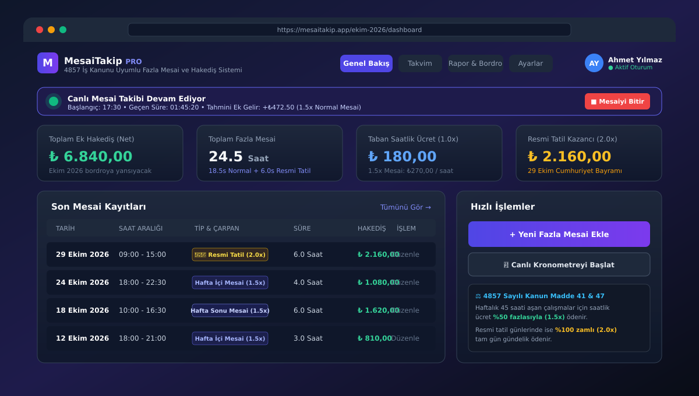
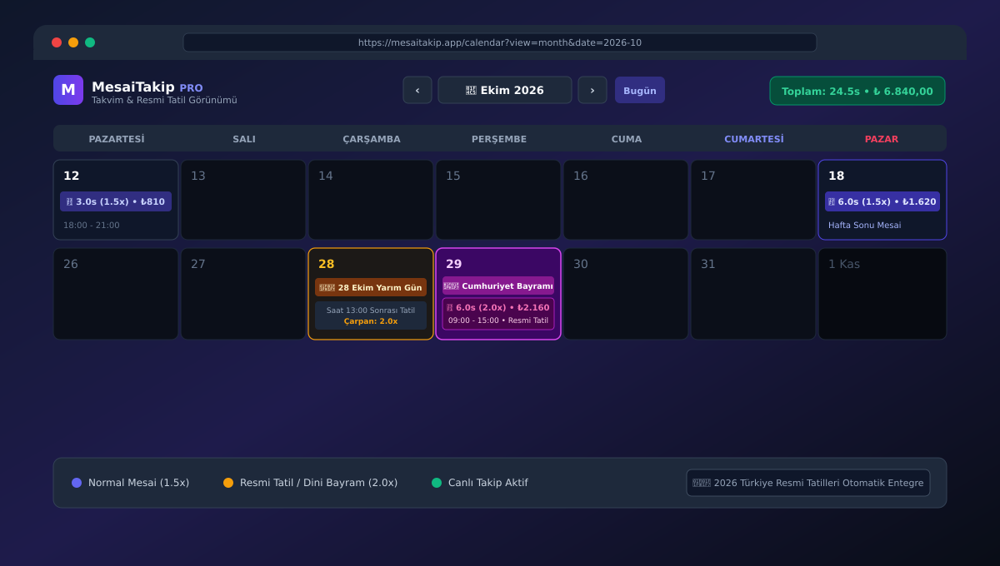
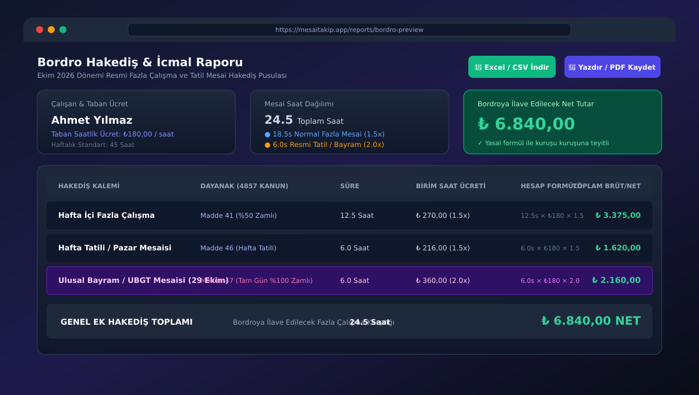

# ⏱️ MesaiTakip PRO

<p align="center">
  
</p>

<p align="center">
  <b>4857 Sayılı İş Kanunu'na Tam Uyumlu Fazla Mesai, Hafta Tatili ve Resmi Tatil Hakediş Takip Sistemi</b>
</p>

<p align="center">
  <a href="#-canlı-demo"></a>
  
  
  
  
  
</p>

---

## 🌟 Proje Hakkında

**MesaiTakip PRO**, Türkiye'deki çalışma hayatında (4857 Sayılı İş Kanunu) yer alan fazla mesai kurallarına göre tasarlanmış modern, güvenli ve kuruşu kuruşuna hesaplama yapan bir web uygulamasıdır. 

Çalışanların fazla mesailerini kaydetmelerini, saatlik taban ücretlerini ister aylık maaştan otomatik hesaplatıp isterlerse serbestçe elle belirleyebilmelerini, resmi tatillerde %100 zamlı (2.0x) ve normal mesailerde %50 zamlı (1.5x) hakedişlerini anlık olarak takip edebilmelerini sağlar. Ay sonunda tek bir tıklamayla **yazdırılabilir bordro pusulası** ve **muhasebe uyumlu CSV/Excel dökümü** sunar.

---

## 🚀 Canlı Demo

Uygulamayı tarayıcınızda doğrudan test edebilirsiniz:
🔗 **[MesaiTakip PRO Canlı Demo Bağlantısı](https://ais-pre-g2ed67j6rrc3nuqxqhudrw-938105776020.europe-west2.run.app)**

> **Not:** Demo hesabı kullanarak hazır örnek verilerle sistemi hemen deneyebilir veya yeni bir kullanıcı açarak tamamen sıfırdan kendi mesailerinizi kaydedebilirsiniz.

---

## 📸 Ekran Görüntüleri

### 1. Genel Bakış & Canlı Mesai Takip Paneli
Ay bazlı net ek gelir, toplam mesai saati, taban saat ücreti ve son mesai kayıtlarının yer aldığı ana gösterge paneli. Canlı kronometre arka planda çalışarak tahmini kazancı saniye saniye hesaplar.

<p align="center">
  
</p>

---

### 2. İnteraktif Takvim & Resmi Tatil Entegrasyonu
Tüm günleri mesai saatleri ve çarpan renkleriyle gösteren takvim görünümü. Türkiye resmi tatilleri (29 Ekim Cumhuriyet Bayramı, 23 Nisan, 1 Mayıs vb.) otomatik olarak işaretlenir ve 2.0x çarpanla işlenir.

<p align="center">
  
</p>

---

### 3. Bordro Hakediş Pusulası & İcmal Raporu
İlgili ayın tüm mesai kalemlerini 4857 Sayılı Kanun maddeleri (Madde 41 ve Madde 47) dayanağı ile listeleyen, PDF/Yazıcı çıktısı ve CSV dökümü sağlayan bordro arayüzü.

<p align="center">
  
</p>

---

## ✨ Öne Çıkan Özellikler

- **⚖️ 4857 Sayılı İş Kanunu Çarpanları:**
  - **Hafta İçi / Normal Fazla Çalışma (1.5x):** Haftalık 45 saati aşan her çalışma için saat başına %50 zamlı ücret.
  - **Ulusal Bayram ve Genel Tatil (UBGT - 2.0x):** Resmi tatillerde çalışılan süreler için kanunun 47. maddesi uyarınca %100 zamlı (çift) yevmiye.
  - **Hafta Tatili / Pazar (1.5x / 2.0x):** Hafta tatili günlerinde yapılan çalışmaların esnek katsayı seçimi.

- **⏱️ Canlı Kronometre & Canlı Hakediş:**
  - Mesaiye başladığınız anda tek tuşla sayacı çalıştırın.
  - Geçen süre ve o ana kadar hak ettiğiniz tahmini ek kazanç anlık olarak panelde ve banner'da güncellenir.

- **💰 Esnek Saatlik Ücret Seçenekleri:**
  - **Maaş Bazlı Hesaplama:** Aylık net maaş ve haftalık çalışma gün sayısı üzerinden saatlik ücretin formülle belirlenmesi.
  - **Manuel Giriş:** Saatlik ücreti serbestçe kuruş hassasiyetinde elle girebilme ve `+₺10`, `+₺50`, `-₺25` hızlı artır/azalt çipleriyle anında güncelleme.

- **📅 2026 Otomatik Resmi Tatil Takvimi:**
  - 1 Ocak Yılbaşı, 23 Nisan Ulusal Egemenlik, 1 Mayıs Emek ve Dayanışma, 19 Mayıs Gençlik ve Spor, 15 Temmuz Demokrasi ve Milli Birlik, 30 Ağustos Zafer Bayramı, 29 Ekim Cumhuriyet Bayramı (ve 28 Ekim yarım gün).
  - Dini bayramlar (Ramazan ve Kurban Bayramı) takvimde özel simge ve açıklamalarıyla yer alır.

- **👥 Güvenli Çoklu Kullanıcı & Temiz Hesap:**
  - Yeni bir kullanıcı kaydolduğunda geçmişe ait sahte veya hazır mesai aktarılmaz; tamamen temiz ve bağımsız bir hesap açılır.
  - Her kullanıcının verileri e-posta bazında LocalStorage üzerinde güvenle izole edilir.
  - Demo hesaba istenildiği zaman tek tıkla geçiş yapılabilir veya güvenli çıkış yapılabilir.

- **📊 Bordro Pusulası ve Excel / CSV Dışa Aktarım:**
  - Resmi bordro pusulası formatında güvenli (iframe destekli, popup engeline takılmayan) yazdırma ve PDF kaydetme.
  - Muhasebe departmanına iletmek üzere tek tıkla UTF-8 BOM destekli Türkçe karakter uyumlu CSV dışa aktarımı.

- **🔔 Akıllı Bildirim Merkezi:**
  - Başarılı kayıt, silme, güncelleme ve mesai bitiş uyarıları.
  - Tek tıkla "Tüm Bildirimleri Temizle" özelliği.

---

## 🛠️ Teknoloji Yığını

- **Frontend:** [React 19](https://react.dev/), [TypeScript](https://www.typescriptlang.org/)
- **Derleyici & Build:** [Vite 6](https://vitejs.dev/)
- **Stil & Tasarım:** [Tailwind CSS v4](https://tailwindcss.com/)
- **İkonlar:** [Lucide React](https://lucide.dev/)
- **Animasyonlar:** [Motion](https://motion.dev/)
- **Depolama:** Tarayıcı Yerel Belleği (LocalStorage) - Çoklu kullanıcı izole şeması

---

## 📂 Proje Dizin Yapısı

```bash
mesaitakip-pro/
├── docs/
│   └── screenshots/         # README için yüksek çözünürlüklü SVG ekran görüntüleri
│       ├── dashboard-preview.svg
│       ├── calendar-view.svg
│       └── salary-slip-bordro.svg
├── public/                  # Statik varlıklar ve PWA ikonları
├── src/
│   ├── components/          # Yeniden kullanılabilir UI bileşenleri
│   │   ├── Header.tsx           # Üst menü, profil açılır penceresi ve çıkış yap
│   │   ├── Navigation.tsx       # Sekme geçişleri
│   │   ├── LiveTrackerBanner.tsx# Canlı kronometre takip çubuğu
│   │   └── AvatarPickerModal.tsx# Profil resmi ve avatar seçici
│   ├── views/               # Ana uygulama sayfaları
│   │   ├── HomeView.tsx         # Dashboard ve son mesailer
│   │   ├── CalendarView.tsx     # İnteraktif takvim ve resmi tatiller
│   │   ├── AddOvertimeView.tsx  # Mesai ekleme/düzenleme ve saatlik ücret girişi
│   │   ├── ReportsView.tsx      # Bordro icmali ve dışa aktarım
│   │   ├── SettingsView.tsx     # Çalışma düzeni ve hesap ayarları
│   │   ├── AuthSetupView.tsx    # Giriş yap ekranı
│   │   └── RegisterView.tsx     # Yeni hesap oluşturma ekranı
│   ├── utils/               # Yardımcı algoritmalar ve hesaplamalar
│   │   ├── holidays.ts          # Türkiye resmi tatil takvimi & UBGT hesaplama
│   │   ├── calendar.ts          # Ay günleri ve dinamik takvim matrisi
│   │   ├── storage.ts           # Kullanıcı bazlı LocalStorage yönetimi
│   │   └── export.ts            # CSV ve güvenli PDF bordro dökümü
│   ├── types/               # TypeScript tip tanımları (OvertimeRecord, UserSettings vb.)
│   ├── App.tsx              # Ana uygulama kabuğu ve durum yönetimi
│   └── main.tsx             # React DOM kök girişi
├── package.json
├── vite.config.ts
└── README.md
```

---

## 💻 Kurulum ve Yerel Çalıştırma

Projeyi kendi bilgisayarınızda çalıştırmak için aşağıdaki adımları izleyin:

### Gereksinimler
- **Node.js** (v18.0.0 veya daha yeni bir sürüm)
- **npm**, **yarn** veya **pnpm**

### 1. Depoyu Klonlayın
```bash
git clone https://github.com/<KULLANICI_ADINIZ>/mesaitakip-pro.git
cd mesaitakip-pro
```

### 2. Bağımlılıkları Yükleyin
```bash
npm install
```

### 3. Geliştirme Sunucusunu Başlatın
```bash
npm run dev
```
Tarayıcınızda `http://localhost:3000` adresine giderek uygulamayı kullanmaya başlayabilirsiniz.

### 4. Üretim (Production) Derlemesi
```bash
npm run build
```
Oluşturulan optimize edilmiş dosyalar `dist/` klasörüne aktarılır. `npm run preview` ile derlenmiş halini test edebilirsiniz.

---

## 📤 Kendi GitHub Hesabınızda Nasıl Paylaşırsınız?

Bu projeyi kendi GitHub hesabınızda repository olarak açıp paylaşmak için şu 3 basit adımı uygulayabilirsiniz:

### Adım 1: GitHub'da Yeni Bir Repository Oluşturun
1. [GitHub](https://github.com)'a giriş yapın.
2. Sağ üstteki `+` butonuna tıklayıp **"New repository"** seçin.
3. Repository adını `mesaitakip-pro` yapın.
4. **"Public"** (Herkese açık) seçin ve **"Create repository"** butonuna basın (README ekle seçeneğini işaretlemeyin, hazır README dosyamız mevcuttur).

### Adım 2: Proje Klasöründe Terminali Açın ve Gönderin
Terminalinizde proje dizinindeyken aşağıdaki komutları çalıştırın (`<GITHUB_KULLANICI_ADINIZ>` kısmını kendi kullanıcı adınızla değiştirin):

```bash
# Uzak repository'yi origin olarak ekleyin
git remote add origin https://github.com/<GITHUB_KULLANICI_ADINIZ>/mesaitakip-pro.git

# Ana dala geçin ve kodları GitHub'a gönderin
git branch -M main
git push -u origin main
```

> **İpucu:** Projede yer alan hazır `push-to-github.sh` betiğini çalıştırarak da repository adresinizi girip tek seferde gönderebilirsiniz:
> ```bash
> chmod +x push-to-github.sh
> ./push-to-github.sh
> ```

---

## ⚖️ Yasal Dayanak & Formül Bilgilendirmesi

Bu uygulama **4857 Sayılı Türk İş Kanunu** esas alınarak geliştirilmiştir:
- **Madde 41:** Haftalık 45 saati aşan çalışmalar fazla çalışma sayılır. Her bir saat fazla çalışma için verilecek ücret, normal çalışma ücretinin saat başına düşen miktarının yüzde elli yükseltilmesi suretiyle ödenir (`Saatlik Ücret × 1.5`).
- **Madde 47:** Kanunlarda ulusal bayram ve genel tatil günü olarak kabul edilen günlerde çalışmazlarsa, bir iş karşılığı olmaksızın o günün ücretleri tam olarak; tatil yapmayarak çalışırlarsa ayrıca çalışılan her gün için bir günlük ücreti ödenir (`Saatlik Ücret × 2.0`).

---

## 📄 Lisans

Bu proje [MIT Lisansı](LICENSE) kapsamında lisanslanmıştır. Dilediğiniz gibi geliştirebilir, kopyalayabilir ve kişisel/kurumsal projelerinizde kullanabilirsiniz.
